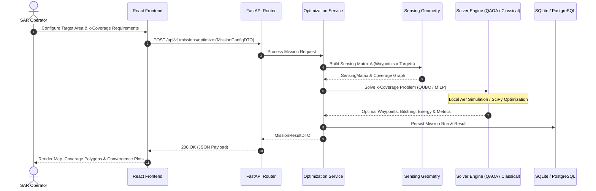

# UAV-QAOA-SAR Architecture Specification

## 1. System Overview
The **UAV-QAOA-SAR** application is an end-to-end, reproducible research and decision-support platform designed to solve the **$k$-Coverage UAV Waypoint Selection Problem** in Search-and-Rescue (SAR) missions. Given a geographical search area containing target interest points (victims, distress beacons, or priority search zones) and candidate sensing waypoints, the system finds the minimal subset of waypoints providing at least $k$-fold redundant sensor coverage across all targets.

The optimization core utilizes the **Quantum Approximate Optimization Algorithm (QAOA)** simulated locally via **Qiskit Aer**, benchmarked directly against classical solvers (Greedy heuristic and Integer Linear Programming / SciPy).

```
+-------------------------------------------------------------------------+
|                              Frontend                                    |
|              (React + Vite + TypeScript + Plotly + Tailwind)             |
+------------------------------------+------------------------------------+
                                     |  HTTP REST / JSON
                                     v
+-------------------------------------------------------------------------+
|                           FastAPI Backend                               |
|   +-----------------------------------------------------------------+   |
|   |                      API Layer (Routers & DTOs)                 |   |
|   +--------------------------------+--------------------------------+   |
|                                    |                                    |
|                                    v                                    |
|   +-----------------------------------------------------------------+   |
|   |                      Service / Orchestration                    |   |
|   +----+---------------------------+---------------------------+----+   |
|        |                           |                           |        |
|        v                           v                           v        |
|  +-----------+           +-------------------+           +------------+ |
|  | Geometry  |           |      Solvers      |           |  Database  | |
|  | & Sensing |           |  (QAOA / SciPy /  |           | (SQLAlchemy| |
|  |  Matrix   |           |      Greedy)      |           | + Alembic) | |
|  +-----------+           +-------------------+           +------------+ |
+-------------------------------------------------------------------------+
                                     |
                                     v
                        Local SQLite / PostgreSQL
```

---

## 2. Architectural Boundaries & Isolation Rules

To maintain high maintainability, unit testability, and adherence to clean architecture principles, the following strict boundaries are enforced:

### Rule 1: Mathematical Logic is Independent of FastAPI
- The `geometry/` and `sar/` modules contain purely algebraic and geometric domain logic: target distribution generation, Euclidean and line-of-sight sensor footprints, sensing matrix $A \in \{0, 1\}^{M \times N}$, and QUBO penalty parameter derivations.
- No imports of `fastapi`, `starlette`, or web-specific abstractions are permitted in these modules.

### Rule 2: Classical Solvers are Independent of Qiskit
- The classical solvers (`GreedySolver`, `SciPyILPSolver`) operate strictly on standard Python, NumPy, and SciPy data structures (`scipy.optimize.milp`).
- No Qiskit or quantum modules are imported or required by classical solvers.

### Rule 3: QAOA Implementation is Isolated in its Own Module
- The `solvers/qaoa/` module encapsulates all quantum circuit construction (`QuantumCircuit`, `QAOAAnsatz`), Ising Hamiltonian representation (`SparsePauliOp`), and simulator runtime (`qiskit_aer.AerSimulator` / `StatevectorSampler`).
- It implements a clean `BaseSolver` interface:
  ```python
  class BaseSolver(ABC):
      @abstractmethod
      def solve(self, problem: OptimizationProblem) -> OptimizationResult:
          pass
  ```

### Rule 4: Database Logic is Decoupled from Optimization
- ORM models (`db/models.py`) define database persistence entities.
- Solvers take pure domain dataclasses (`OptimizationProblem`) and produce immutable result models (`OptimizationResult`), without direct queries or commits inside solver algorithms.
- Repositories or application service layers manage state transitions and database writes.

### Rule 5: Frontend-Backend Decoupling via HTTP REST
- The React application communicates exclusively through standard JSON HTTP endpoints (`/api/v1/...`).
- No quantum libraries or simulations execute in the browser.

### Rule 6: Hardware Agnostic & Zero Cloud Credentials
- All quantum circuits execute locally via `Qiskit Aer` local simulator.
- No IBM Quantum API tokens or external cloud services are required for local reproducibility.

---

## 3. Data Flow Architecture



---

## 4. Module Responsibilities

| Module Path | Layer | Responsibility |
| :--- | :--- | :--- |
| `backend/core/` | Infrastructure | Configuration settings (`BaseSettings`), logging, custom exceptions. |
| `backend/db/` | Persistence | SQLAlchemy declarative base, session factories, Alembic migrations. |
| `backend/models/` | Domain / DTO | Pydantic schemas for request/response validation and domain data transfer. |
| `backend/sar/` | Domain Math | Target coordinate generation, sensor disk models, sensing matrix generation. |
| `backend/solvers/qubo/` | Optimization | QUBO formulation of Set Multicover, penalty parameter calculation, Ising conversion. |
| `backend/solvers/qaoa/` | Quantum Engine | Parameterized QAOA circuit construction, expectation evaluation, Aer execution. |
| `backend/solvers/classical/` | Classical Baseline | Greedy multi-cover heuristic, SciPy binary integer linear programming solver. |
| `backend/services/` | Application | Coordinates geometry generation, solver execution, timing, and database persistence. |
| `backend/api/` | Presentation | FastAPI route handlers, validation error formatters, dependency injection. |
| `frontend/src/` | Client UI | Interactive map layout, mission parameters form, Plotly metric visualizers. |

---

## 5. Storage & Database Schema

The database supports both **SQLite** (local zero-setup development) and **PostgreSQL** (production deployment) via SQLAlchemy ORM.

### Key Entities:
1. **`Mission`**:
   - `id` (UUID / Integer Primary Key)
   - `name` (String)
   - `area_bounds` (JSON: `[xmin, ymin, xmax, ymax]`)
   - `k_coverage` (Integer)
   - `sensor_radius` (Float)
   - `created_at` (DateTime)
2. **`Target`**:
   - `id`, `mission_id` (Foreign Key), `x`, `y`, `priority` (Float)
3. **`Waypoint`**:
   - `id`, `mission_id` (Foreign Key), `x`, `y`, `cost` (Float)
4. **`OptimizationRun`**:
   - `id`, `mission_id` (Foreign Key)
   - `solver_type` (Enum: `qaoa`, `scipy_milp`, `greedy`)
   - `status` (Enum: `pending`, `running`, `completed`, `failed`)
   - `selected_waypoints` (JSON array of waypoint IDs)
   - `coverage_achieved` (Float: percentage of targets meeting $k$-coverage)
   - `execution_time_ms` (Float)
   - `energy_or_cost` (Float)
   - `quantum_metrics` (JSON: optimal angles $\gamma, \beta$, state probabilities, circuit depth)

